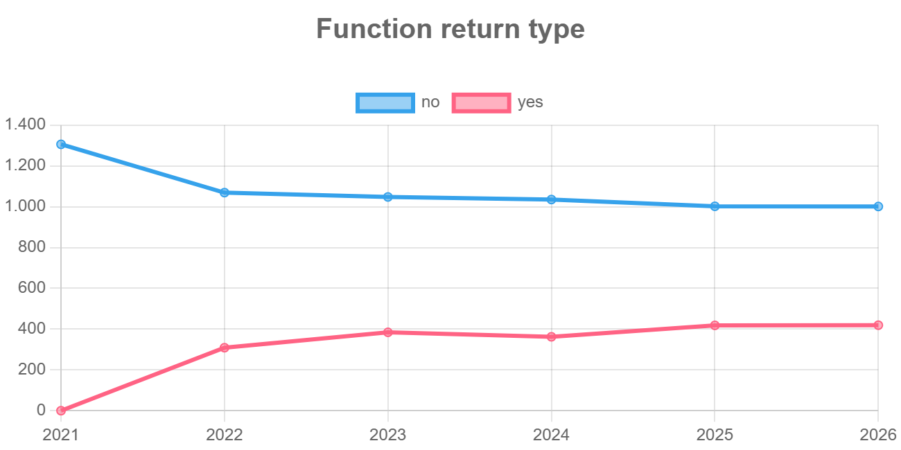

# Explorando a evolução de código com GitEvo

## Repositório selecionado

- Repositório analisado: [pallets/flask](https://github.com/pallets/flask) (Python)
- Relatório HTML do GitEvo (todos os gráficos): [report_flask.html](report_flask.html)
  (o relatório carrega o Chart.js por CDN, então precisa de internet para exibir os gráficos; baixe o arquivo e abra no navegador, pois o GitHub mostra apenas o código-fonte do HTML)

## Gráfico selecionado

**Function return type** (tipo de retorno de funções): para cada ano (2021 a 2026), o gráfico conta quantas funções do código Python do Flask **não** têm anotação de tipo de retorno (`no`, linha azul) e quantas **têm** (`yes`, linha rosa), como em `def f() -> str:`. Cada ponto é uma fotografia do repositório no início do ano (1º de janeiro de 2021, 13 de janeiro de 2022, 1º de janeiro de 2023, 1º de janeiro de 2024, 5 de janeiro de 2025 e 5 de janeiro de 2026).

## Explicação

Em janeiro de 2021, nenhuma das 1.306 funções do Flask tinha tipo de retorno anotado (`yes` = 0, `no` = 1.306). Em janeiro de 2022 já eram 309 funções com anotação e 1.069 sem, ou seja, cerca de 22% do total. Depois disso a curva sobe devagar: 384 anotadas em 2023 (27%), 362 em 2024 (26%), 418 em 2025 (29%) e 419 em 2026 (29,5%). A linha azul faz o movimento contrário e cai de 1.306 para 1.001. Quase toda a mudança acontece em um único salto, entre 2021 e 2022; nos anos seguintes o crescimento é pequeno, e de 2025 para 2026 a curva praticamente para. A anotação dos parâmetros, que não está neste gráfico mas está no relatório, segue o mesmo padrão: parâmetros com tipo (`typed_parameter`) vão de 0 para 321 em 2022 e chegam a 465 em 2026.

Isso reflete uma boa prática: anotações de tipo servem como documentação dentro do próprio código e permitem que ferramentas como mypy e pyright encontrem erros sem executar o programa. A causa do salto está registrada no [CHANGES.rst](https://github.com/pallets/flask/blob/main/CHANGES.rst) do Flask: a versão 2.0.0, lançada em 2021-05-11, traz a entrada "Add type hinting" (PR [#3973](https://github.com/pallets/flask/pull/3973)). Esse PR foi integrado em 2021-04-27, e o arquivo `src/flask/py.typed`, que informa aos usuários que o pacote traz tipos, foi criado em 2021-04-23 no commit "Initial typing support" (`f405c6f1`). Como a fotografia de 2021 foi tirada em 1º de janeiro, antes desses commits, ela mostra zero anotações, e a de 2022 já mostra o resultado da 2.0.

Depois da 2.0, o CHANGES.rst mostra que o trabalho de tipagem passou a ser de manutenção, com muitas entradas do tipo "Fix type annotation for ..." (por exemplo `errorhandler`, `teardown_*`, `send_file`) e, na 3.0.1 (2024), "Address more type findings when using mypy strict mode" (PR [#5383](https://github.com/pallets/flask/pull/5383)). O `pyproject.toml` atual confirma que a prática virou parte do processo: o projeto declara o classificador `Typing :: Typed`, configura o mypy com `strict = true`, inclui mypy e pyright no grupo de dependências `typing` e tem um ambiente de teste `typing` no tox e um job `typing` no workflow de testes do GitHub Actions (`.github/workflows/tests.yaml`). Ou seja, a documentação e a configuração do projeto confirmam que a tipagem é uma decisão deliberada, e não um acaso.

A queda em 2024 (de 384 para 362 funções anotadas, enquanto o total de funções caiu de 1.432 para 1.397 e as linhas de código de 18.138 para 17.466) não aparece explicada no CHANGES.rst. Uma **hipótese**, que não verifiquei, é que o código removido ou reescrito entre as duas fotografias continha funções anotadas; o relatório sozinho não permite confirmar isso. Outra **hipótese**, também não verificada, é que as cerca de 1.000 funções sem anotação em 2026 estejam em grande parte nos testes (31 dos 83 arquivos Python são de teste) e em código que não faz parte da API pública, o que explicaria por que a curva se estabiliza abaixo de 30% mesmo com o mypy em modo estrito rodando em `src`. Em resumo: o gráfico mostra uma adoção de tipos rápida e concentrada em 2021, seguida de manutenção, e essa história é confirmada pelas notas de versão e pela configuração do projeto.
